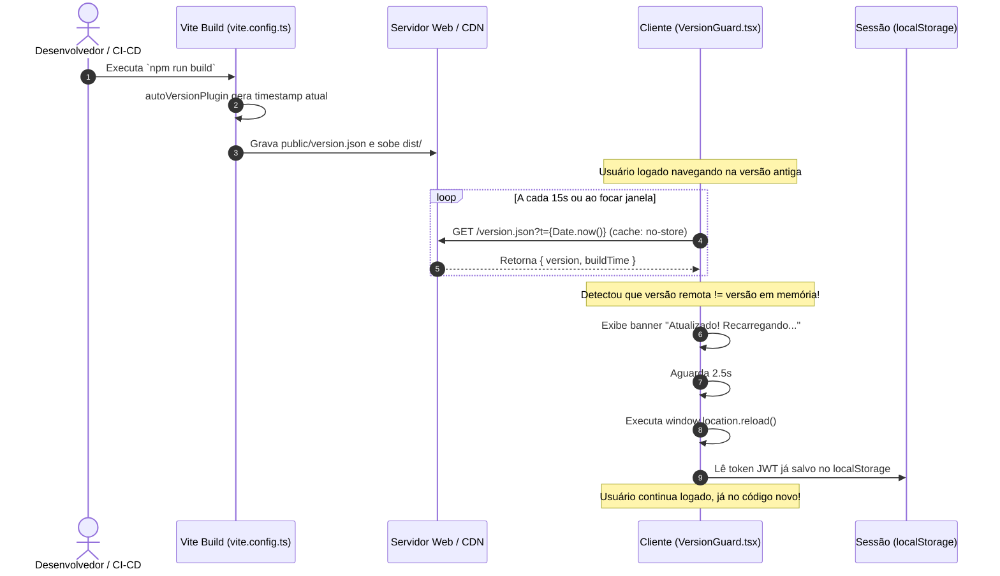

# Guia de Implementação: Atualização Automática e Forçada em SPAs (Vite + React)

Este documento descreve a arquitetura e o passo a passo para replicar o sistema de atualização automática do **GoPlay** em qualquer outro projeto web ou WebView móvel.

---

## 1. O Problema que este Sistema Resolve

Em aplicações de página única (SPAs) e PWAs/WebViews:
1. **Código defasado**: Usuários costumam deixar abas abertas no computador ou apps minimizados no celular por semanas.
2. **Erros de chunk (404)**: Quando você sobe um deploy novo, os hashes dos arquivos `.js` mudam. Usuários na versão antiga tentam navegar para rotas lazy-loaded e o app quebra porque o arquivo JS antigo não existe mais no servidor.
3. **Incompatibilidade de API**: Se você altera o schema do backend/banco (ex: Supabase) e o usuário continua rodando o código antigo, ele envia payloads incompatíveis gerando erros silenciosos.

### A Solução
Um ciclo simples: **geração automática de versão no build** + **monitoramento contínuo em background no cliente** + **reload transparente sem perda de sessão**.

---

## 2. Diagrama de Funcionamento



---

## 3. Passo a Passo de Implementação

### Passo 1: Criar o arquivo de versão inicial
Na raiz do projeto, crie o arquivo `public/version.json`:

```json
{
  "version": "1.0.0",
  "buildTime": "2026-01-01T00:00:00.000Z"
}
```

> **Nota:** Como o arquivo fica na pasta `public/`, o Vite copiará automaticamente para a pasta final `dist/version.json`, tornando-o acessível diretamente na raiz da URL (`https://seu-app.com/version.json`).

---

### Passo 2: Configurar o Plugin no `vite.config.ts`
Adicione o plugin `autoVersionPlugin` para que toda vez que o projeto for compilado (`npm run build`), o arquivo `version.json` receba uma nova versão única baseada no carimbo de data e hora:

```typescript
import { defineConfig } from 'vite'
import react from '@vitejs/plugin-react'
import type { Plugin } from 'vite'
import fs from 'fs'
import path from 'path'
import { fileURLToPath } from 'url'

const __dirname = path.dirname(fileURLToPath(import.meta.url))

function autoVersionPlugin(): Plugin {
  return {
    name: 'auto-version',
    buildStart() {
      const versionPath = path.resolve(__dirname, 'public/version.json')
      const now = new Date()
      
      // Formato: AAAA.M.D-HHMMSS (Ex: 2026.10.13-221500)
      const version = [
        now.getFullYear(),
        now.getMonth() + 1,
        now.getDate()
      ].join('.') + '-' + [
        String(now.getHours()).padStart(2, '0'),
        String(now.getMinutes()).padStart(2, '0'),
        String(now.getSeconds()).padStart(2, '0')
      ].join('')

      const content = JSON.stringify({ 
        version, 
        buildTime: now.toISOString() 
      }, null, 2) + '\n'

      fs.writeFileSync(versionPath, content, 'utf-8')
      console.log(`\n🔄 [AutoVersion] version.json atualizado → v${version}\n`)
    }
  }
}

export default defineConfig({
  plugins: [
    react(),
    autoVersionPlugin()
  ]
})
```

---

### Passo 3: Criar o Componente Sentinela (`VersionGuard.tsx`)
Crie o componente responsável por vigiar o arquivo no servidor em `src/components/common/VersionGuard.tsx`:

```tsx
import { useEffect, useRef, useState } from 'react';
import { motion, AnimatePresence } from 'framer-motion';
import { RefreshCw } from 'lucide-react';

export default function VersionGuard() {
  const currentVersion = useRef<string | null>(null);
  const [showBanner, setShowBanner] = useState(false);
  const intervalRef = useRef<ReturnType<typeof setInterval> | null>(null);

  useEffect(() => {
    // 1. Função para buscar a versão no servidor sem risco de cache
    async function fetchVersion(): Promise<string | null> {
      try {
        const res = await fetch(`/version.json?t=${Date.now()}`, {
          cache: 'no-store',
          headers: { 'Cache-Control': 'no-cache' },
        });
        if (!res.ok) return null;
        const data = await res.json();
        return data.version || null;
      } catch {
        return null;
      }
    }

    // 2. Grava a versão inicial na montagem do app
    fetchVersion().then((v) => {
      if (v) currentVersion.current = v;
    });

    // 3. Checagem de mudança
    const checkVersion = async () => {
      const latest = await fetchVersion();
      if (!latest || !currentVersion.current) return;

      // Se a versão do servidor for diferente da que está em execução
      if (latest !== currentVersion.current) {
        console.log(`[VersionGuard] Nova versão: ${currentVersion.current} → ${latest}. Recarregando...`);
        setShowBanner(true);

        // Aguarda 2.5s para o usuário ler o banner e recarrega
        setTimeout(() => {
          window.location.reload();
        }, 2500);
      }
    };

    // Gatilho A: Polling a cada 15 segundos
    intervalRef.current = setInterval(checkVersion, 15 * 1000);

    // Gatilho B: Usuário volta para a aba ou desbloqueia o celular
    const handleVisibilityChange = () => {
      if (document.visibilityState === 'visible') {
        checkVersion();
      }
    };
    window.addEventListener('visibilitychange', handleVisibilityChange);
    
    // Gatilho C: Janela recebe foco
    window.addEventListener('focus', checkVersion);

    return () => {
      if (intervalRef.current) clearInterval(intervalRef.current);
      window.removeEventListener('visibilitychange', handleVisibilityChange);
      window.removeEventListener('focus', checkVersion);
    };
  }, []);

  return (
    <AnimatePresence>
      {showBanner && (
        <motion.div
          initial={{ y: -80, opacity: 0 }}
          animate={{ y: 0, opacity: 1 }}
          exit={{ y: -80, opacity: 0 }}
          transition={{ duration: 0.35, ease: 'easeOut' }}
          className="fixed top-0 left-0 right-0 z-[99999] flex items-center justify-center gap-3 px-5 py-3.5 bg-blue-600 text-white shadow-xl"
        >
          <RefreshCw size={16} className="animate-spin shrink-0" />
          <span className="text-xs font-bold uppercase tracking-wide">
            🚀 Nova versão disponível! Atualizando em instantes...
          </span>
        </motion.div>
      )}
    </AnimatePresence>
  );
}
```

> **Dica:** Caso seu outro projeto **não** utilize `framer-motion` ou `lucide-react`, você pode renderizar uma `<div>` padrão com Tailwind puro (`fixed top-0 left-0 right-0 z-50 ...`) ou CSS comum.

---

### Passo 4: Registrar no Raiz da Aplicação (`App.tsx`)
Basta colocar o `<VersionGuard />` dentro do container principal da aplicação:

```tsx
import VersionGuard from './components/common/VersionGuard';

export default function App() {
  return (
    <div className="min-h-screen">
      {/* Sentinela de versão */}
      <VersionGuard />
      
      {/* Suas rotas e componentes */}
      <Routes>
        ...
      </Routes>
    </div>
  );
}
```

---

## 4. Por que o Usuário NÃO é Deslogado?

No modelo moderno de autenticação (ex: Supabase, Firebase, Auth0, JWT em `localStorage`):
* O token e a sessão do usuário estão salvos no `localStorage` ou `sessionStorage`.
* O `window.location.reload()` apenas limpa o estado de memória (React State / Context) e faz download do novo bundle HTML/JS/CSS.
* Assim que o app reabre, o hook de autenticação (ex: `useAuth`) lê o token persistido e restaura o usuário logado instantaneamente, **sem passar pela tela de login**.

---

## 5. Cuidados Importantes para Produção (CDN & Servidores)

Para que a checagem funcione sem falhas, garanta que a CDN (Vercel, Cloudflare, Netlify ou Nginx) nunca armazene em cache o arquivo `version.json`.

### Configuração para Vercel (`vercel.json`)
```json
{
  "headers": [
    {
      "source": "/version.json",
      "headers": [
        {
          "key": "Cache-Control",
          "value": "no-store, no-cache, must-revalidate, proxy-revalidate, max-age=0"
        }
      ]
    }
  ]
}
```

### Configuração para Nginx
```nginx
location = /version.json {
    add_header Cache-Control "no-store, no-cache, must-revalidate, proxy-revalidate, max-age=0";
    expires -1;
}
```

---

## 6. Variação: Atualização com Confirmação Manual

Se o seu outro projeto contiver telas com formulários longos ou fluxos transacionais sensíveis, você pode preferir **não recarregar compulsoriamente**.

Basta trocar o `setTimeout(() => window.location.reload(), 2500)` por um botão interativo no banner:

```tsx
{showBanner && (
  <div className="fixed bottom-4 right-4 z-[99999] p-4 bg-slate-900 text-white rounded-2xl shadow-2xl border border-slate-700 flex items-center gap-4">
    <div>
      <p className="text-sm font-bold">Nova versão disponível! 🚀</p>
      <p className="text-xs text-slate-400">Atualize para receber as últimas melhorias.</p>
    </div>
    <button
      onClick={() => window.location.reload()}
      className="px-4 py-2 bg-blue-600 hover:bg-blue-500 text-white text-xs font-bold rounded-xl transition cursor-pointer"
    >
      Atualizar Agora
    </button>
  </div>
)}
```
